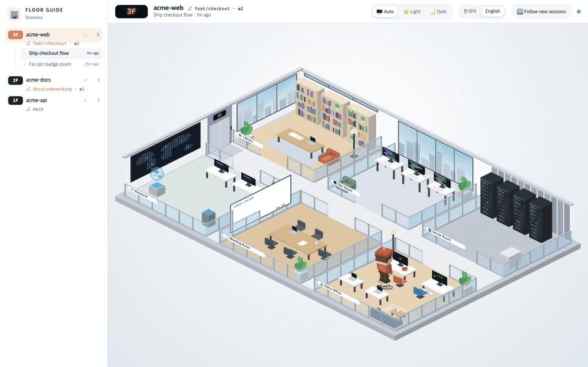
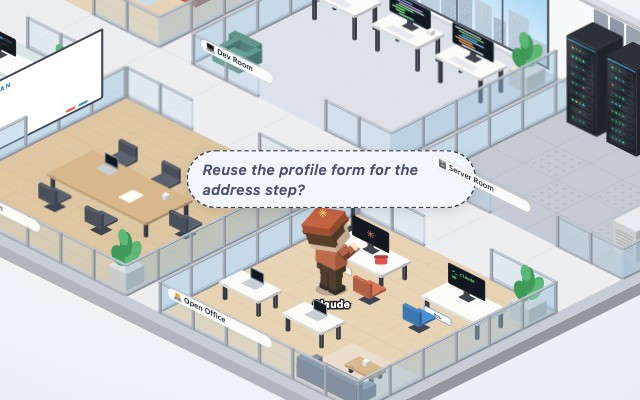
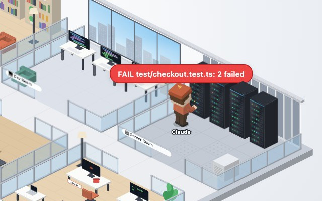
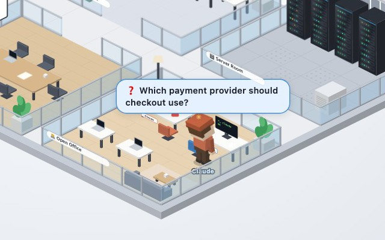
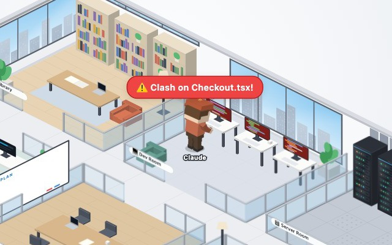

<div align="center">


# Panoptes

An isometric office that moves along with your Claude Code sessions.

**English** · [한국어](README.ko.md)

</div>



Panoptes shows what your AI coding agents are doing as you work. It reads the session logs that Claude Code and Codex CLI write on your machine, then animates characters in a small isometric office to match.

- **A room for each kind of work.** Reading files happens in the library, edits in the dev room, shell commands in the server room, and web searches in the research room.
- **Subagents arrive by elevator.** They work alongside Claude, report back, and go home when they finish. Codex runs that Claude starts show up as subagents too.
- **One floor per project.** Each floor shows that project's git branch and status, plus a store for each session.
- **Same-file warnings.** You get an alert when two sessions edit the same file at the same time.
- **Light and dark themes**, with Korean and English UI.

| Thinking | A command failed |
|:---:|:---:|
|  |  |
| **Asking you a question** | **Two sessions editing the same file** |
|  |  |

## Quick start

```bash
npm install
npm run dev                  # http://127.0.0.1:5173
# or
npm run build && npm start   # http://127.0.0.1:4317
```

Panoptes runs entirely on your machine. It listens on 127.0.0.1 only and masks common secrets before anything reaches the page. See [SECURITY.md](SECURITY.md) for details.

## More

- [Docs](docs/README.md): features, configuration, architecture, development
- [Contributing](CONTRIBUTING.md)
- [Security policy](SECURITY.md)
- License: [MIT](LICENSE)
